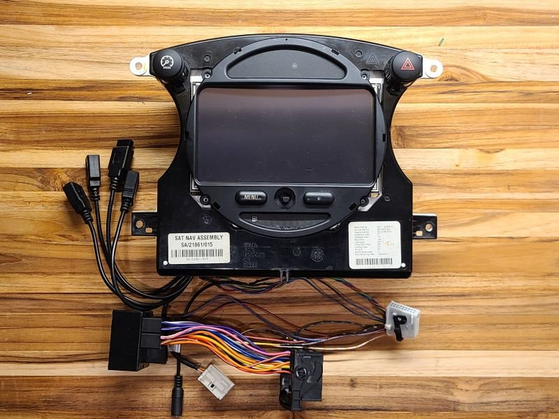
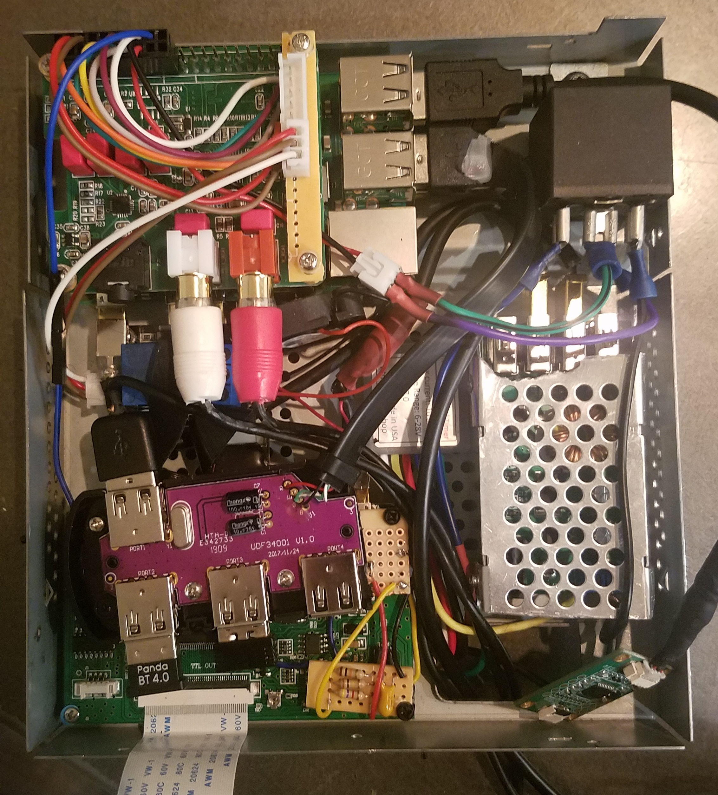
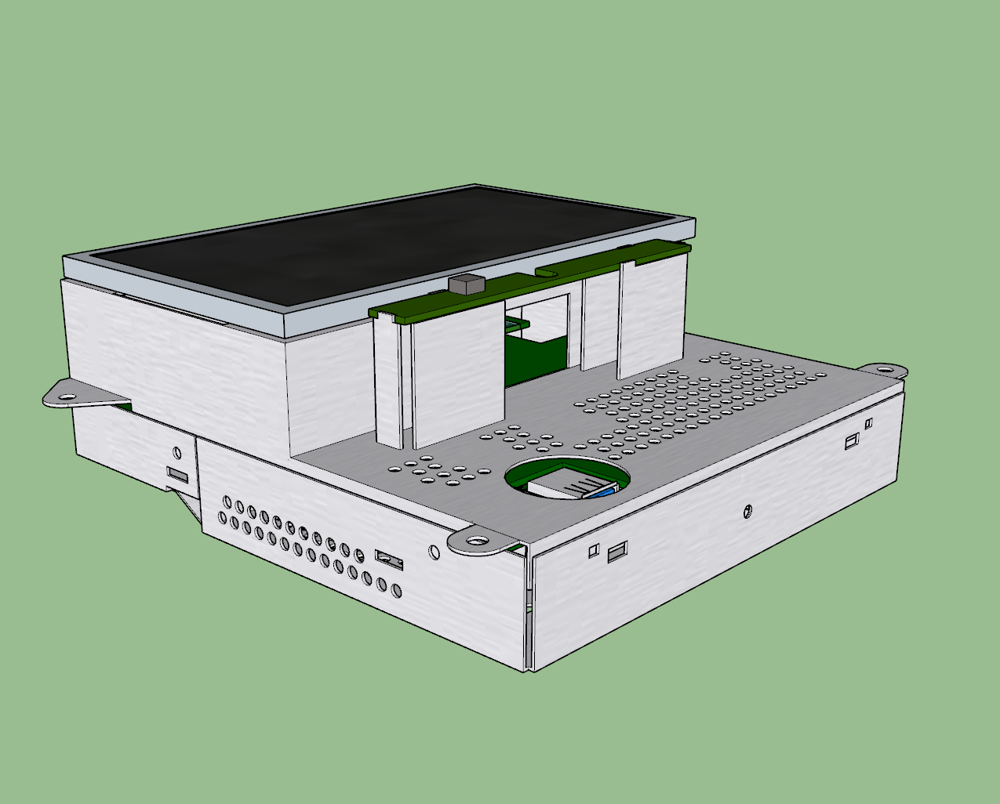
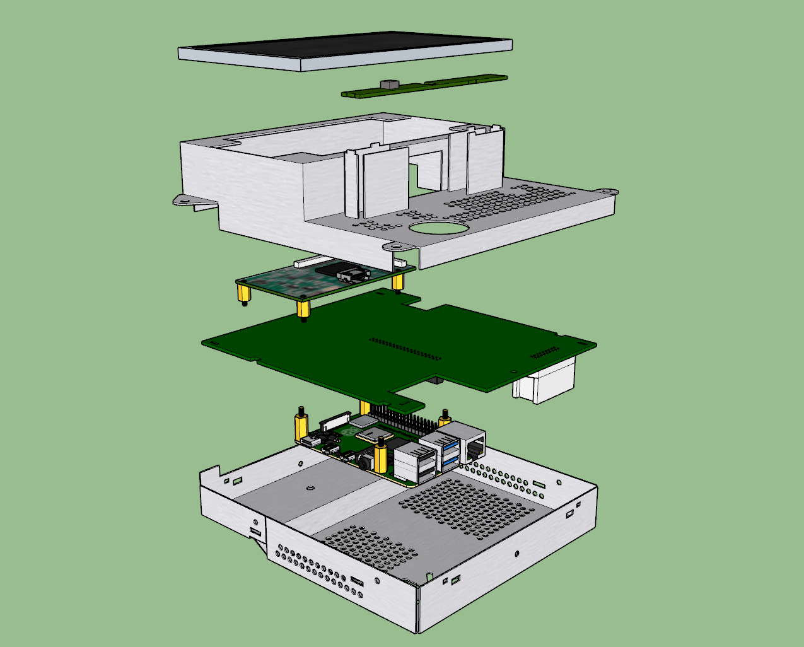
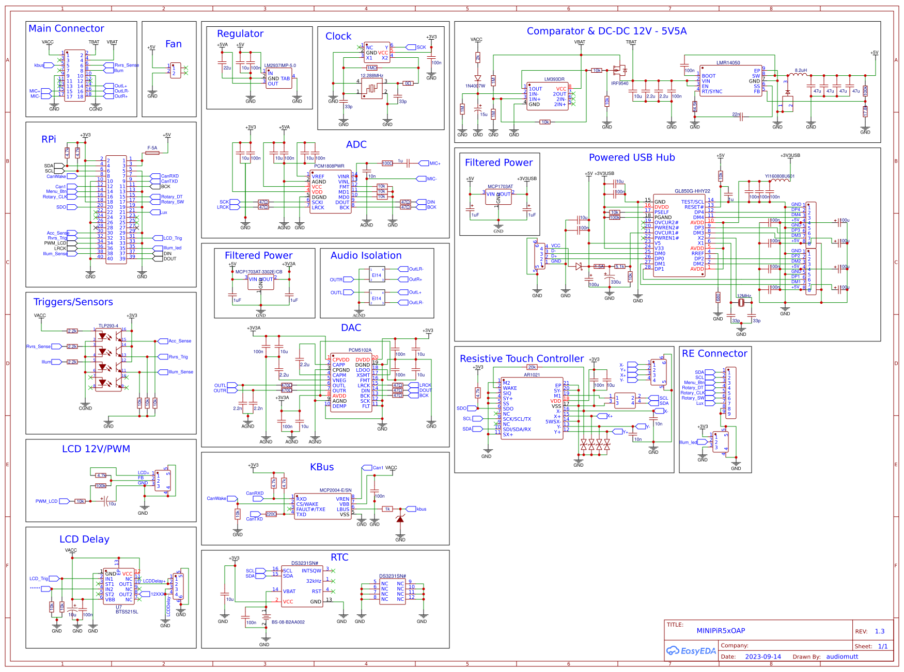
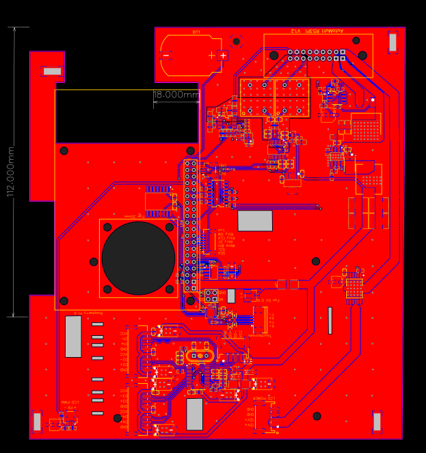
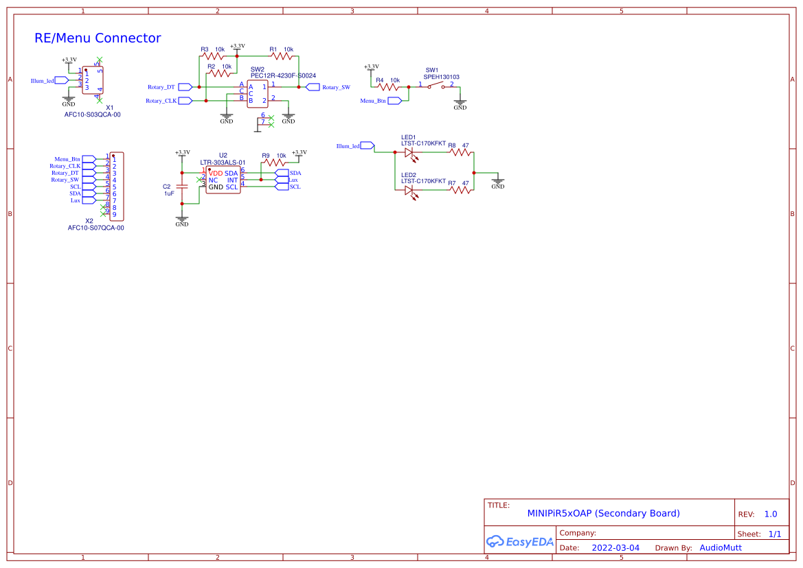
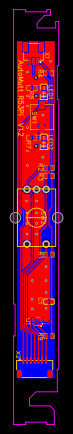

# MINI R50/R52/R53 OEM-Style Raspberry Pi Head Unit

**Designed and built by Chris Click**  
**North American Motoring:** `AutoMutt`

A multi-year effort to modernize a first-generation MINI without making the interior look modernized.

I started with a Raspberry Pi and OpenAuto Pro, then kept solving the problems that appeared around it: packaging the system inside the factory navigation housing, retaining physical controls, integrating factory audio, managing automotive power, adding a rear camera, building custom PCBs, writing control software, and reverse-engineering the MINI center display so the conversion could remain OEM-style.

The result became a working in-car system and, more importantly, a project that forced me to work across mechanical, electrical, software, audio, and user-experience problems.

> **Status:** Working personal prototype / engineering archive. OpenAuto Pro was the application layer in the final 2024 build; it is now historical rather than a recommended platform for a new installation.




## What I owned

I was responsible for the overall concept, research, system architecture, PCB design/layout, physical integration, bench and in-car testing, troubleshooting, and iteration.

The project includes:

- a custom main integration PCB;
- a separate rotary/menu/ambient-light control PCB;
- Raspberry Pi software for ignition-aware shutdown and physical controls;
- factory radio / line-level audio integration;
- reverse-camera and display-control integration;
- RTC, OBD-II, USB, illumination, and vehicle-state inputs;
- reuse of the original MINI navigation connector and housing;
- related reverse engineering of the MINI KOMBI/navigation electronics.

## What this project demonstrates

This repository is less about a Raspberry Pi than the process I used to get from an idea to a working system:

- **Define the constraint first.** The system had to look and behave as though it belonged in the car.
- **Prototype across disciplines.** Mechanical packaging, PCB design, Linux/Python, audio, vehicle wiring, and UI behavior all had to work together.
- **Test assumptions in the real environment.** Several solutions that worked on paper were changed after in-car testing.
- **Choose the better outcome over defending the original design.** I kept external modules where they were more reliable than my integrated circuits.
- **Document failure as well as success.** The engineering notes identify design mistakes, recovery paths, and unresolved areas rather than presenting the project as cleaner than it was.

## From prototype to integrated system




*The first prototype proved the Raspberry Pi / OpenAuto Pro concept, but also made clear that a finished installation would require much deeper integration.*

The later design moved the electronics into the factory navigation assembly and consolidated much of the system onto custom hardware.


| Complete assembly | Exploded view |
| --- | --- |
|  |  |

## Custom hardware

### Main integration PCB — Rev 1.3

The main PCB ties together the Raspberry Pi, audio path, power/control logic, display hardware, RTC, USB, touch, and conditioned vehicle inputs.

Key devices include `LMR14050`, `PCM5102`-family DAC, `DS3231`, `GL850G`, `AR1021`, `BTS5215L`, and an experimental `MCP2004` K-Bus interface.





**EasyEDA / OSHWLab:**  
<https://oshwlab.com/chrisclick/minipir5xoap-main-board-rev1-3>

### Front-control PCB

I designed a second board so the system could keep the interaction style of the factory navigation unit instead of becoming touchscreen-only. It carries the rotary encoder, menu button, ambient-light sensing, and OEM-style illumination.





**EasyEDA / OSHWLab:**  
<https://oshwlab.com/chrisclick/mcoop-carpi_copy>

## Selected design decisions

**OEM fit over a larger screen.** I mocked up a 7-inch display and rejected it because it changed the character of the center stack. The final design kept a 6.5-inch 800×480 panel.

**Physical controls over touch-only.** The rotary encoder and buttons remained useful while driving, so I designed them into the system rather than treating the OEM controls as decoration.

**Direct camera switching over extra software.** I tested a USB-capture path through the Pi and a direct composite path through the display controller. The direct hardware switch was faster and had fewer failure points.

**Perceived startup over benchmark startup.** The final system begins booting from a door-light trigger before the driver turns the key. It does not make Linux boot faster; it moves the wait earlier in the user journey.

## Iteration

The project did not work perfectly on the first board.

Among the issues I worked through:

- a USB-hub section designed from the wrong IC revision;
- a touchscreen connection omitted during an early PCB layout;
- an integrated touch-controller path that never became reliable enough to keep;
- a microphone ADC that worked but did not meet my audio-quality bar;
- materially different behavior between similar-looking video-controller revisions;
- power/startup assumptions that changed after testing in the actual car.

By 2024 the system was stable enough that I stopped redesigning for the sake of integration. The final installation uses the custom hardware where it adds value and a few external modules where they proved better.

## Software

The recovered 2024 software includes ignition-aware delayed shutdown, physical-control mapping, PWM backlight control, vehicle-state monitoring, systemd services, and installation automation.

**[Software & Control System](docs/SOFTWARE_CONTROL_SYSTEM.md)**

The actual recovered files should live under:

```text
software/archived-2024/
```

## Related reverse engineering

Before completing the head-unit hardware, I worked through a separate problem: converting the MINI center module from Chrono Pack to the factory Navigation display while preserving the car's correct identity and configuration.

That work included R260/Rosfar bench programming, EEPROM/FLASH backup and recovery, identifying practical vehicle-data transfer regions, restoring a corrupted donor, and documenting NCS Expert / INPA verification. Later community work explicitly carried forward findings from my testing.

**[KOMBI / Navigation Reverse Engineering](docs/KOMBI_REVERSE_ENGINEERING.md)**

## Documentation

- **[Engineering / Design Record](docs/HEAD_UNIT_DESIGN.md)** — architecture, hardware decisions, board iteration, subsystem behavior, and known prototype issues.
- **[Software & Control System](docs/SOFTWARE_CONTROL_SYSTEM.md)** — recovered 2024 software architecture and source-file guide.
- **[KOMBI Reverse Engineering](docs/KOMBI_REVERSE_ENGINEERING.md)** — personally tested programming/recovery work and community context.
- **[Community Credits & Research Provenance](docs/COMMUNITY_CREDITS.md)** — attribution and project lineage.

## Scope

This is a personal prototype connected to automotive 12 V electronics, not a certified product. Anyone adapting it should independently validate power protection, fusing, grounding, thermal behavior, GPIO isolation, wiring, and current software compatibility.

