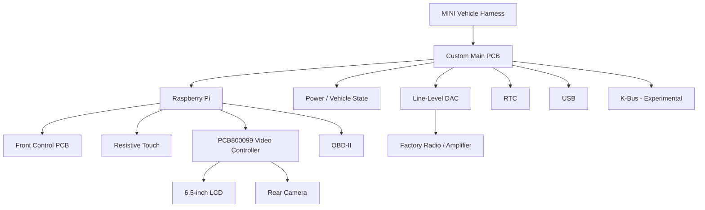

# MINI R50/R53 OEM-Style Raspberry Pi Head Unit

## Engineering / Design Record

**Author:** Chris Click (`AutoMutt`)  
**Platform:** MINI R50/R52/R53  
**Main-board design:** Rev 1.3  
**Compute:** Raspberry Pi  
**Original application:** OpenAuto Pro  
**Display:** 6.5-inch, 800×480  
**State:** working installed prototype

This is the engineering record behind the project shown in the main README. It focuses on the decisions, architecture, iteration, and subsystem behavior rather than trying to document every component as a build manual.

## 1. Design brief

My requirement was not simply to add a screen. I wanted modern head-unit functionality while preserving the first-generation MINI interior.

That created a set of practical constraints:

- fit inside the factory navigation housing;
- retain physical controls;
- reuse the factory audio path and connector where practical;
- handle automotive startup/shutdown behavior;
- integrate lighting and rear-camera behavior;
- remain serviceable when a prototype subsystem failed.

I owned the overall concept, component research, architecture, PCB design/layout, physical integration, bench testing, in-car testing, troubleshooting, and iteration.

## 2. Architecture

The main board remained the integration point, but I moved several functions to external modules when testing showed they were the better solution.

## 3. Hardware I designed

### Main PCB — Rev 1.3

The board was shaped around the factory navigation assembly and consolidated most of the electrical integration.

| Function | Device / approach | Result |
|---|---|---|
| 12 V → 5 V | LMR14050 | Integrated prototype; power architecture would deserve additional validation before reuse |
| Power-state logic | LM393DR / switching | Used around accessory/battery behavior |
| LCD power | BTS5215L | High-side switching |
| Line audio | PCM5102-family DAC | Worked well |
| Mic input | PCM1808 ADC | Functional, but USB mic sounded better |
| RTC | DS3231 | Working |
| Touch | AR1021 | Detected; external controller ultimately preferred |
| USB hub | GL850G | Required revision/iteration |
| K-Bus | MCP2004 | Designed; not validated in final install |
| Vehicle state | conditioned inputs | Accessory, reverse, illumination |

**Source:** <https://oshwlab.com/chrisclick/minipir5xoap-main-board-rev1-3>

### Front-control PCB

The second board kept the OEM-style physical interface:

- `PEC12R-4230F-S0024` rotary encoder;
- `SPEH130103` menu button;
- `LTR-303ALS` ambient-light sensor;
- OEM-style illumination.

It was fabricated, tested, and worked as intended.

**Source:** <https://oshwlab.com/chrisclick/mcoop-carpi_copy>

## 4. Development and iteration

### Early prototype

The initial installation proved that a Raspberry Pi/OpenAuto Pro system could work in the car, but not that it felt integrated.

A 7-inch display was physically possible, but a mockup and 3D-printed faceplate looked too aftermarket. I returned to the 6.5-inch form factor because the visual constraint was part of the product requirement.

### Board iteration

An early board delivered working power, accessory sensing, controlled shutdown, line audio, reverse sensing, illumination sensing, OBD-II, and RTC, but also exposed two clear mistakes:

1. the USB-hub section was designed against a datasheet revision that did not match the IC revision selected;
2. a Raspberry Pi connection for the integrated touchscreen path was omitted during layout.

Later revisions corrected routing and changed connector locations, USB integration, power capability, LCD switching, and microphone support.

### Final installed configuration

By 2024 I stopped optimizing for maximum integration and kept the solutions that performed best:

- custom main PCB;
- custom front-control PCB;
- external startup timer;
- external resistive-touch controller;
- USB condenser microphone;
- preferred green PCB800099 controller for reliable PWM dimming.

That became an important project lesson: **integration is only useful when it improves the system.**

## 5. Final subsystem status

| Subsystem | Final result |
|---|---|
| Raspberry Pi / system power | Working with revised/external arrangement |
| Graceful shutdown | Working |
| Door-open pre-boot | Working |
| Factory line-level audio | Working well |
| Rotary / menu controls | Working |
| Resistive touch | Working with external controller |
| RTC | Working |
| OBD-II | Working |
| Rear camera | Working; direct video-controller path preferred |
| LCD PWM dimming | Working with preferred PCB800099 revision |
| USB microphone | Working / preferred |
| Onboard PCM1808 mic path | Not retained |
| Integrated AR1021 touch path | Not retained |
| K-Bus | Experimental / unvalidated |

## 6. Key engineering decisions

### Startup and shutdown

The system needed to behave differently from a desktop computer. The software watches accessory state and performs a delayed clean shutdown; a separate trigger begins startup when the door opens so the boot delay starts before the driver is ready to use the system.

See **[Software & Control System](SOFTWARE_CONTROL_SYSTEM.md)**.

### Audio

The Pi outputs stereo line-level audio into the factory MINI radio/AUX path. This preserved the factory amplification and avoided replacing the full audio signal chain.

The integrated PCM1808 microphone path was eventually functional but did not meet my quality standard, so I used a USB condenser microphone instead.

### Display

The final display is an Innolux AT065TN14 6.5-inch 800×480 panel.

I tested multiple PCB800099 controller revisions. The older green-board version with the PT4103 backlight driver behaved significantly better for PWM dimming than the blue AP3032-based boards I tried.

### Touch

I chose resistive touch after real-world testing showed the previous capacitive setup was inconsistent with very dry or sweaty hands. The integrated AR1021 path was not reliable enough, so the final system uses an external controller.

### Rear camera

I tested both software capture through the Pi and direct composite switching through the video controller. Direct switching won because it was faster and removed the Pi from the critical path.

### Factory connector

I de-soldered and reused the original MINI navigation connector so the vehicle-side harness did not need to be cut.

## 7. Vehicle I/O

The recovered 2024 software provides the best record of the final Raspberry Pi GPIO mapping:

| Function | BCM GPIO |
|---|---:|
| Accessory / ignition sense | 5 |
| Reverse sense | 6 |
| LCD backlight control | 12 |
| LCD PWM | 13 |
| Control illumination output | 16 |
| Rotary encoder A / B | 22 / 23 |
| Encoder / primary switch | 24 |
| Illumination sense | 26 |
| Menu / mode switch | 27 |

For actual replication, use the schematic/source design rather than this table alone.

## 8. What changed my approach

The most useful failures were not exotic:

- **Wrong datasheet revision:** component identity matters down to the exact part/revision.
- **Missed PCB connection:** schematic correctness does not guarantee layout completeness.
- **Power redesign without enough bench validation:** validate major subsystem changes before paying for another board.
- **Integrated does not mean better:** external touch and microphone solutions produced better results.
- **Mechanical serviceability matters:** connector placement and access became design requirements after working on the installed unit.
- **Similar modules can behave differently:** the two PCB800099 variants looked interchangeable but were not equivalent in practice.

Those lessons are more representative of the project than a perfect schematic would have been.

## 9. Source designs and related work

- Main board Rev 1.3: <https://oshwlab.com/chrisclick/minipir5xoap-main-board-rev1-3>
- Front-control board: <https://oshwlab.com/chrisclick/mcoop-carpi_copy>
- [Software & Control System](SOFTWARE_CONTROL_SYSTEM.md)
- [KOMBI Reverse Engineering](KOMBI_REVERSE_ENGINEERING.md)
- [Community Credits](COMMUNITY_CREDITS.md)

## 10. Safety / scope

This is prototype automotive hardware, not a reference-certified design. Anyone adapting it should independently validate fusing, transient/load-dump protection, reverse-polarity protection, grounding, thermal behavior, current draw, connector ratings, and GPIO isolation.
