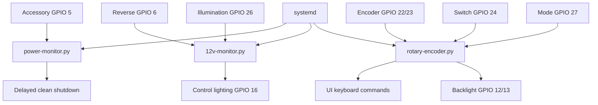

# MINI R50/R53 Head Unit — Software & Control System
 
**Original UI platform:** OpenAuto Pro (OAP)

The hardware solved only half the problem. I also needed a Raspberry Pi to behave like an embedded automotive system: respond to ignition state, shut down cleanly, preserve physical controls, manage display brightness, monitor vehicle signals, and start those functions automatically.

The recovered 2024 files are preserved under:

```text
software/
```

> OpenAuto Pro was the application layer used in the working build. It is no longer the platform I would choose for a new installation, so the OAP-specific mappings are historical. The vehicle-state, shutdown, control, RTC, and service-management ideas are still reusable.

## Architecture



I intentionally kept most vehicle-facing behavior outside OAP. That reduced the amount of logic tied directly to the media application.

## Final saved interface map

| Function | BCM GPIO / interface |
|---|---:|
| Accessory / ignition sense | 5 |
| Reverse sense | 6 |
| LCD backlight | 12 |
| LCD PWM | 13 |
| Control illumination output | 16 |
| Rotary encoder A / B | 22 / 23 |
| Encoder / primary switch | 24 |
| Illumination sense | 26 |
| Menu / mode switch | 27 |
| RTC | I2C / DS3231 |
| Audio | I2S |


## 1. Ignition-aware shutdown

**File:** [`power-monitor.py`](../software/power-monitor.py)

A Raspberry Pi should not simply lose power when the key is removed. This service watches accessory state on GPIO 5.

When ignition disappears, it starts a **14.5-minute delay**. If accessory power returns and stays back for five seconds, the pending shutdown is canceled. Otherwise Linux receives an orderly shutdown command.

That gave the system two useful behaviors at once:

- short stops did not force a full reboot;
- longer parking periods still ended with a clean shutdown rather than an abrupt power cut.

The companion service file is:

[`power-monitor.service`](../software/power-monitor.service)

## 2. Physical controls and backlight

**File:** [`rotary-encoder.py`](../software/rotary-encoder.py)

The factory-style rotary control needed to do more than generate clicks.

The final script:

- detects the rotary encoder as a Linux input device;
- maps rotation to UI keyboard commands;
- distinguishes short/medium/long button presses;
- switches between **Scroll Mode** and **Backlight Mode**;
- drives LCD PWM brightness;
- provides brief on-screen mode notifications;
- cleans up GPIO on exit.

The OAP keyboard mappings are application-specific, but the control concept is not. A modern version could keep the physical-control layer and swap in a different UI adapter.

Companion service:

[`rotary-encoder.service`](../software/rotary-encoder.service)

## 3. Vehicle-state monitor

**File:** [`12v-monitor.py`](../software/12v-monitor.py)

This service watches conditioned GPIO-level signals for:

- accessory state;
- illumination state;
- reverse state.

It uses GPIO edge detection and drives the control-lighting output from the illumination signal.

The recovered reverse callback reports the state but does not itself launch camera software. During development I also used direct camera switching through the video controller, which ultimately became my preferred path because it removed the Pi from the camera-switching loop.

Companion service:

[`12v-monitor.service`](../software/12v-monitor.service)

## 4. Raspberry Pi configuration

**File:** [`config.txt`](../software/config.txt)

The saved configuration shows the final system enabling:

- I2C for the DS3231 RTC;
- I2S for the audio interface;
- the rotary-encoder overlay on GPIO 22/23;
- a HiFiBerry DAC+ADC-compatible audio overlay;
- the graphics settings required by that OAP-era Pi installation.

These settings document the working environment; they should not be copied blindly to a current Raspberry Pi OS release.

## 5. Making rebuilds repeatable

Once setup included Python packages, RTC changes, custom services, permissions, and splash assets, rebuilding an SD card became its own problem.

I created helper scripts and eventually a combined installer:

- [`Full-install.sh`](../software/Full-install.sh)
- [`software-update.sh`](../software/software-update.sh)
- [`services-install.sh`](../software/services-install.sh)

`Full-install.sh` automated package installation, custom-file placement, service installation/enablement, OAP splash assets, and reboot.

It was not a polished public installer; its purpose was to make my own environment reproducible instead of relying on memory.

## 6. Recovered file set

```text
software/
└── archived-2024/
    ├── 12v-monitor.py
    ├── power-monitor.py
    ├── rotary-encoder.py
    ├── 12v-monitor.service
    ├── power-monitor.service
    ├── rotary-encoder.service
    ├── config.txt
    ├── Full-install.sh
    ├── services-install.sh
    ├── software-update.sh
    ├── splash1.h264
    ├── splash2.h264
    └── Mini-logo.jpg
```

The splash assets and MINI logo are preserved because they were part of the working OAP-era installation, not because they are required by the hardware.

## 7. What I would carry forward

A new UI platform would require different application-specific controls, but I would keep the same separation of concerns:

- vehicle state and ignition management;
- graceful shutdown;
- physical-control service;
- display/backlight control;
- RTC and audio configuration;
- systemd-managed startup;
- application-specific commands isolated behind an adapter.

That is the part of the software design that outlived OAP.

## 8. Provenance

I designed and integrated the overall system and wrote or adapted the code while working through the project. Some approaches came from documentation and the OpenAuto Pro hobbyist community, whose original forum is no longer available.

Where I cannot reconstruct the original source of an early snippet, I do not claim sole authorship. The recovered files are included as the actual working-era artifacts.

## Safety

The Python code expects **conditioned GPIO-level signals**. Never connect vehicle 12 V directly to Raspberry Pi GPIO.
